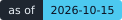
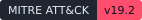
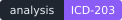
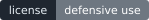
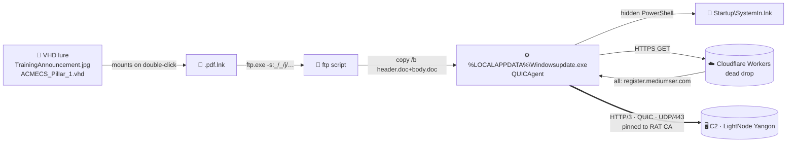

<p align="center">
  
</p>

<p align="center">
  
  
  
  
  
  
  
  
</p>

<h3 align="center">A Go backdoor that hides its C2 in HTTP/3 over QUIC, pins it to a private "RAT CA",<br>and has been spying on Myanmar's government and diplomats since December 2025.</h3>

<p align="center">
  <b>Intelligence</b> · <b>reverse engineering</b> · <b>infrastructure</b> · <b>detections</b> · <b>hunts</b> — all in one place, all passive, all validated.
</p>

---

## ⚡ Bottom line

| | |
|---|---|
| **Who** | **Operation QUICSILVER**, backdoor **QUICAgent** (Seqrite, 17 Aug 2026) — same operator as **GriefLure** |
| **Assessed as** | **China-nexus — likely** (low–moderate confidence). No named group adopted |
| **Targets** | Myanmar **government** (ITCSD / MOTC, Ministry of Foreign Affairs), **foreign missions and NGOs** in Myanmar, regional forums (**ASEAN, BIMSTEC, ACMECS**) |
| **Signature move** | A **VHD** (one copy renamed `TrainingAnnouncement.jpg`) → a `.pdf.lnk` that runs **`ftp.exe -s:`** → **`copy /b header.doc+body.doc`** → **QUICAgent** → **Cloudflare Worker** dead drop → C2 over **QUIC / UDP 443** |
| **When** | **December 2025 → 18 August 2026** — four months earlier than published |
| **Right now** | Dormant: the C2 name went NXDOMAIN on 19 Aug and both Workers serve an error page. The zone is still live — one record re-arms every implant |
| **So what** | Your TLS proxy probably never sees QUIC. **Control UDP/443 egress**, stop **VHD auto-mount**, and hunt **`ftp.exe -s`**. Every rule is in [`detections/`](detections/) |

---

## 🧠 Key judgments

| # | Judgment | Likelihood | Confidence |
|---|---|---|---|
| **KJ1** | The operation was **running by December 2025**, four months before the earliest published date | **Almost certain** | High |
| **KJ2** | QUICAgent is a **private toolset with two code lineages** (`agent`, `rat/agent`) from **one developer** (`qwe`) | **Very likely** | High |
| **KJ3** | The operator runs **one VHD as a lure factory**, swapping the decoy about monthly | **Likely** | Moderate |
| **KJ4** | The operator is **China-nexus** | **Likely** | Low–moderate |
| **KJ5** | C2 will be **rebuilt** on new resolvers and **LightNode (AS154177)** servers | **Likely** | Moderate–low |
| **KJ6** | Defences that inspect only TCP/TLS **will miss the C2** | **Very likely** | Moderate |

Evidence and change triggers: [strategic](docs/01-strategic-intelligence.md#key-judgments) · [attribution](docs/04-attribution-assessment.md).

---

## 🧭 Start here

| | | |
|:--|:--|:--|
| 🎖️ **[01 · Strategic](docs/01-strategic-intelligence.md)**<br>Who, what they want, threat assessment, outlook | 🔁 **[02 · Operational](docs/02-operational-intelligence.md)**<br>Ten-month timeline, three generations, kill chain, reaction to exposure | 🎯 **[03 · Tactical](docs/03-tactical-intelligence.md)**<br>Ten fingerprints, ATT&CK, host and network artefacts |
| 🧮 **[04 · Attribution](docs/04-attribution-assessment.md)**<br>Evidence weights, GriefLure link, ACH | 🔬 **[05 · Reverse engineering](docs/05-reverse-engineering.md)**<br>Four builds, two lineages, resolver bug, certificates, VHD and LNK | 🌐 **[06 · Infrastructure](docs/06-infrastructure.md)**<br>Resolvers, domains, LightNode, the lure factory |
| 🛡️ **[07 · SOC defender guide](docs/07-soc-defender-guide.md)**<br>First 60 minutes, playbooks, hardening | 🔭 **[08 · Threat hunting](docs/08-threat-hunting-playbook.md)**<br>12 hypotheses, passive pivots, open leads | 📚 **[09 · Methodology](docs/09-methodology-and-corrections.md)** · **[10 · Sources](docs/10-sources.md)**<br>Tags, corrections log, dated nulls |

---

## 🔗 The attack chain



---

## 🚨 Detect it today

| # | Fingerprint | Fidelity | Rule |
|---|---|---|---|
| 1 | **`ftp.exe -s"":_/_/j/_/_/_/_/_/_`** started from a mounted VHD | Very high | Sigma · [KQL Q01](detections/kql/defender-xdr-hunting.kql) · [SPL S01](detections/spl/splunk-hunting.spl) |
| 2 | **`cmd.exe copy /Y /b …header.doc+…body.doc "%LOCALAPPDATA%\Windowsupdate.exe"`** | Very high | Sigma · KQL Q02 · SPL S02 |
| 3 | **`Startup\SystemIn.lnk`** written by PowerShell from **`%TEMP%\create_lnk_*.ps1`** | Very high | Sigma · KQL Q04 · SPL S04 |
| 4 | **QUIC (UDP/443) from a user-writable binary** right after HTTPS to `*.workers.dev` | Very high | KQL Q11 · SPL S11 · Suricata `quic.sni` |
| 5 | **Embedded `RAT CA` / `RAT-TeamServer` PEM**, the **RC4 key built on the stack**, or quic-go + `/heartbeat` `/result` + `X-Idempotency-Key` + the lineage's upload paths | Very high | [YARA](detections/yara/quicsilver.yar) |

**Full catalogue, triage and hardening:** [SOC defender guide](docs/07-soc-defender-guide.md) · **validation:** [detections/README](detections/README.md#validation)

---

## 💎 What this repository adds

All first-hand, all passive. Tagged  unless marked.

| Finding | Why it matters |
|---|---|
| A **December 2025 build** (`2655c016`, a **memory image** dumped after loading) that resolved its C2 to **38.60.244.92** on **26 Dec 2025** | Moves the start **four months** earlier; a public sample sat unnoticed for four months. Its hash is the dump's — hunt it by YARA, not hash |
| **Two code lineages**: `agent` (Dec → Jun/Aug) and `rat/agent` (Apr). June is an **edit of the December `main.go`** — 29 functions in the same order; April is a separate rewrite | Hunt both; a takedown of one leaves the other |
| Developer environment: Windows user **`qwe`**, projects **`C:\go agent`** and **`C:\go agent 2`** | YARA that survives new C2s and certificates |
| **RAT-TeamServer** (April pin) and **RAT CA** (Dec/Jun pin) both minted on **5 Dec 2025**, ~2 h apart | The setup day for the whole operation |
| The **RAT CA–signed `CN=localhost` C2 certificate** found on Censys (15 Jul 2026), **rebuilt and signature-verified** | An internet-scale fingerprint for live servers |
| **130.94.100.181** (12–18 Aug) and a **LightNode AS154177** pattern: 3 of 4 actor C2 IPs, including a return after Linode | Where the next C2 will probably be |
| **The lure factory**: one VHD held **eight decoy slots** (Jan → Jun 2026; four real documents — the current ACMECS decoy is a **corrupt** file), swapped in **one second**; Seqrite's "unrelated" deleted documents were its earlier decoys | Earlier lures to hunt for; corrects the published reading |
| The deleted **`header.doc`**: an earlier payload (Go build ID `_sw2KbxsC…`) in the container **13 Jan → 14 May 2026**, **likely `agent` lineage** — section sizes within 15 KB of the December build, ~300 KB from April. Likely replaced within seconds on 14 May; the current June halves date from **≥ 25 Jun** | The lure carried an implant (likely `agent`) from the day it was built |
| Builder artefacts beyond the hostname: MAC **`80:45:dd:e5:91:6e`**, DROID 2024-05-20, volume serial `C205DAF6`, label **`我的磁盘`** (GBK) | Links future LNKs to the same machine; the one independent locale artefact |
| **Two operator clocks** (UTC−8/−7 and UTC−3) in one 21-minute session; one clock ≥ 2 days off | VM + host or two people; date stamps need care |
| Both **Workers now return `error code: 1042`**, and the implant turns that into the "C2" `https://error code: 1042error code: 1042:443` | The fleet is orphaned — until the operator fixes a Worker |
| Seqrite's Worker path **`/vere0zme82cadre` is wrong** — a Go string-table mis-read; the binary uses **`/vere0zme82cad`** (copied by three outlets) | Correct blocking and hunting |
| The **August respin** `c15aead1` differs from the June build by **one byte** in `.reloc` slack | Hash rotation; the Go build ID still matches |
| **December installer**: skips its install step if **Bitdefender** or **SentinelOne** is running; else `SystemPublicCache`, `attrib +h +s`, relaunch, self-delete | Changes what an infected host looks like |
| **April internals**: **SentinelOne or Trend Micro → no install** (it hides itself and runs in place), Bitdefender → `cmd /c` relaunch; the copy deletes the original and `original_path.txt` after ~1 s; **deletes `Downloads\*.hta`**; embedded `sample.pdf` decoy; `C:\Users\Public\original_path.txt`; `/register`, `/upload/chunk/pull`, typed results; its own RC4 key **`2024axcegbaxcegb`** | New host artefacts — and a hint of an HTA delivery stage |
| **June internals**: registers a **vectored exception handler and raises an exception** before persistence (likely anti-debug); `create_lnk_*.ps1` via **hidden PowerShell, `-ExecutionPolicy Bypass`**; `launchViaCOM`; resolver timeout 10 s; failover list; beacon range 1–3,600 s | A first-chance exception at start-up; exact command lines to hunt |
| The C2 **never answered a sandbox** (0 server packets in four runs over eight months); quic-go's **1,280-byte Initial** train is the on-wire signature | Don't trust "no C2 seen"; a network pattern to hunt |
| Seqrite's RC4 key is right (CORROBORATED) but is **never stored as a string** — four `movabs` stores build it on the stack, so string searches miss it | YARA **`RC4_Key_Builder`** catches both lineages, on disk and in memory |
| `maui-cocktailbar.com`: an **aged small-business domain** re-registered **6 Jun 2025**, six months before use; `mediumser.com` registrant e-mail is **single-use** | Watch aged-domain re-registrations; WHOIS pivot |
| The **GriefLure template** was still in use on **18 Aug 2026** (Viettel-themed RAR) | The operator's tradecraft outlived both reports |
| The Workers stopped handing out the C2 name between **15 and 18 Aug** (likely; around the report, possibly just before it); `register.mediumser.com` went **NXDOMAIN 1–2 days after** the report | The clearest reaction to exposure is the DNS deletion |

---

## 🔖 How to read it

| Tag | Meaning |
|---|---|
|  | First-hand ANCHOR finding, not in any public report on the date given |
|  | Published by others **and** confirmed first-hand |
|  | A vendor claim we cite but did not confirm |
|  | Examined and ruled out — reasons in [`iocs/excluded.csv`](iocs/excluded.csv) |

Likelihood uses **ICD-203** terms (*likely* = 55–80 %, *very likely* = 80–95 % …). Confidence rates the evidence, not the claim. Every null carries a date. Twenty-seven of our own corrections — fourteen of them caught by **two independent pre-release reviews** — and three corrections to published reporting are logged in the open: [methodology and corrections](docs/09-methodology-and-corrections.md).

---

## 📂 Repository map

```text
quicsilver-quicagent-cti/
├── docs/            01 strategic · 02 operational · 03 tactical · 04 attribution · 05 reverse engineering
│                    06 infrastructure · 07 SOC guide · 08 threat hunting · 09 methodology · 10 sources
├── detections/      YARA · Sigma · KQL (Defender XDR) · SPL (Splunk) · Suricata 7 (quic.sni) · Zeek   + validation table
├── hunting/
│   ├── queries/     passive Censys / Shodan / FOFA / Validin pivots
│   └── data/        C2 resolution timeline · lure-factory timeline · sandbox runs
├── iocs/            iocs.csv · file-hashes.csv · excluded.csv · related-grieflure.csv · blocklists/ · stix/
├── attack/          mapping.csv · Navigator layer coloured by evidence tag
├── tools/           QUICAgent triage · VHD Recycle-Bin timeline · LNK tracker · C2-leaf verifier · export builder
├── tests/           run_all.sh · validators · YARA expectations and results
└── assets/          banner · badges
```

---

## 🔒 Handling

- **TLP:CLEAR.** No malware, no payloads, no private keys in this repository. The pinned certificates in `tools/data/` are public certificates.
- **Passive collection only.** No contact with actor infrastructure; sandbox data comes from existing public reports.
- **Bystanders protected.** `104.64.211.22` now runs someone else's workload, and `maui-cocktailbar.com` has a new, unrelated owner — use their **date windows**. The domain's former legitimate owner is not named.
- **No victim organisations.** Decoys are referenced by hash only — do not re-host them.
- **Indicators expire.** Respect `first_seen` / `last_seen`.

---

## 📜 License

Defensive use — see [LICENSE](LICENSE). Provided as is. Test every rule against your own baseline before production.

<p align="center"><sub>ANCHOR · Operation QUICSILVER · Colonel Yanky Wilson · 2026</sub></p>
