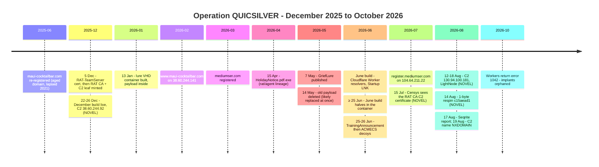
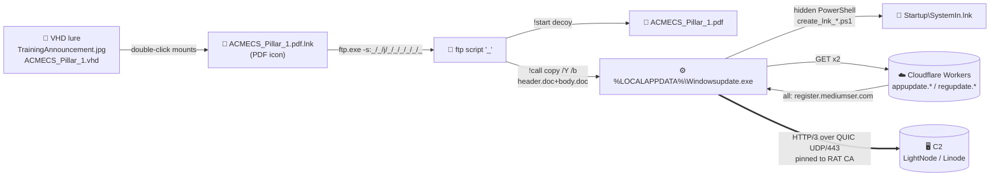

# 02 · Operational intelligence

[⬅ Strategic](01-strategic-intelligence.md) · **Operational** · [Tactical ➡](03-tactical-intelligence.md)

> **TLP:CLEAR** · as of **2026-10-15** · all times **UTC** unless marked *local*.
> Audience: intelligence analysts, incident responders, threat hunters.

---

## Ten months in one picture

---

## Full timeline

| Date (UTC) | Event | Source | Tag |
|---|---|---|---|
| 2018–2021 | `maui-cocktailbar.com` is a real small business's site (shared Dutch hosting); lapses in 2021 | WHOIS history, OTX | NOVEL |
| **2025-06-06 03:09** | Domain **re-registered** at Namecheap; appears in the SANS ISC new-domain feed on 2025-06-08 | VirusTotal WHOIS, SANS ISC | NOVEL |
| **2025-12-05** ~05:58–06:08 | **RAT-TeamServer** certificate generated (RSA-2048, NotBefore 05:57:54, one year) | April build | NOVEL |
| **2025-12-05 08:17:02** | **RAT CA** and its **`localhost` C2 leaf** generated (same second, ten-year validity) | December/June builds; Censys | NOVEL (leaf) |
| **2025-12-22 08:23** | **December build `2655c016`** reaches Triage through a bulk sample feed | Triage 251222-kah8asynej | NOVEL |
| **2025-12-26 ~09:20** | Sandbox run: `www.maui-cocktailbar.com` → **38.60.244.92** (LightNode, Yangon); QUIC Initials, no reply | Triage (server `Date` headers) | NOVEL |
| 2026-01-12 *local* | Old `header.doc` last written (mtime 01:20:34 on the container-builder's clock) | VHD FAT | NOVEL |
| **2026-01-13 06:13:38** | **Lure VHD created** (footer) — FAT stamps 22:13 *local* → builder clock at **UTC−8** | VHD footer + FAT | NOVEL |
| 2026-01-13 06:16:52 | `ACMECS_Pillar_1.pdf.lnk` (then unnamed lure LNK) written into the container | VHD FAT | NOVEL |
| 2026-01-29 → 02-04 | Decoy slot: `25-1-2026.pdf` | Recycle Bin | NOVEL |
| 2026-02-07 → 03-18 | Decoy slot: `Unofficial_Translation.pdf` (a 265-byte stub) | Recycle Bin | NOVEL |
| ≥ 2026-02-07 | `www.maui-cocktailbar.com` → **38.60.244.141** | VirusTotal | NOVEL (date) |
| 2026-03-13 → 03-17 | Apex → 27.102.128.147 (DAOU, KR, shared); Let's Encrypt certs 13 and 16 Mar; MX + SPF 14 Mar–25 Apr | Validin, CT | NOVEL (low weight) |
| **2026-03-20** | `mediumser.com` registered (NameSilo; registrant `jack.amy2015@atomicmail.io`) | Seqrite (date); WHOIS (e-mail) | CORROBORATED / NOVEL |
| 2026-03-20 → 03-25 | Decoy slot: `Virtual_Training_Programme.pdf` (BIMSTEC / MISIS concept note) | Recycle Bin | NOVEL (dates) |
| **2026-04-15** | **April build** HolidayNotice.pdf.exe (`rat/agent`) on Triage; C2 `www.maui-cocktailbar.com` → 38.60.244.141 | Triage 260415-d3xg3ad14q | CORROBORATED |
| 2026-04-29 | `mediumser.com` moves to Cloudflare DNS | Validin | NOVEL |
| **2026-05-07** | Seqrite publishes **GriefLure** (same template, same builder `desktop-stv6gg`) | Seqrite | PUBLISHED |
| ≥ 2026-05-12 | `register.mediumser.com` → 38.60.244.141 | VirusTotal | NOVEL |
| **2026-05-14 01:27–01:48** | **Old payload deleted**: `header.doc` at 01:37 on a **UTC−7** clock — and **likely replaced within seconds** (the current `header.doc` inherited its creation time, the signature of file-system tunnelling). Two decoys deleted on a **UTC−3** clock: the 265-byte stub at 01:27 and the 54,759-byte `5-14-2026.pdf` at 01:48 | Recycle Bin; FAT | NOVEL |
| mid-May → 06-25 | Decoy slot: `5-14-2026.pdf` ("Inside Story of Trump's Visit to China", Myanmar MFA look-alike). Its FAT stamp says 16 May, on a clock that ran ≥ 2 days off | Recycle Bin; Seqrite (content) | NOVEL (dates) |
| ~2026-06-06 | `maui-cocktailbar.com` expires; registrar parking 16–30 Jun | WHOIS, Validin | NOVEL |
| June 2026 | **June build** (`agent`, cgo, `-trimpath`, Worker resolvers) in TrainingAnnouncement.jpg | Seqrite | CORROBORATED |
| **2026-06-25 07:19:29–30** | `5-14-2026.pdf` out, `TrainingAnnouncement.pdf` in — **one second** apart | Recycle Bin + FAT | NOVEL |
| ≥ 2026-06-25 04:27:42 *local* | **Current payload halves** (= June build `cd147efe`) last modified at this time on an unknown clock; `copy` keeps the source mtime, so they went in **on or after** it. Which payload sat in the slot 14 May → 25 Jun is unknown | VHD FAT | NOVEL |
| **2026-06-26 15:43:25–26** | `ACMECS_Pillar_1.pdf` in, `TrainingAnnouncement.pdf` out — **one second** apart | Recycle Bin + FAT | NOVEL |
| 2026-07-01 → 07-06 | `register.mediumser.com` → 38.60.244.141 | Seqrite (Validin) | PUBLISHED |
| **2026-07-07 → 08-11** | → **104.64.211.22** (Linode) | Seqrite; Validin; SecurityTrails | CORROBORATED |
| **2026-07-15 09:16** | Censys records the **RAT CA–signed `CN=localhost` leaf** | Censys (rebuilt + verified by us) | NOVEL |
| July 2026 | ACMECS_Pillar_1.vhd seen in the wild | Seqrite | PUBLISHED |
| 2026-07-30 22:09–22:10 *local* | The ftp script and `ACMECS_Pillar_1.pdf.lnk` last modified inside the container | VHD FAT | NOVEL |
| **2026-08-12 → 08-18** | → **130.94.100.181** (LightNode, Yangon) | Validin, SecurityTrails, VirusTotal, OTX | NOVEL |
| **2026-08-14 20:30** | **August respin `c15aead1`** (1 byte changed) resolves `register.mediumser.com` → 130.94.100.181 | Triage 260814-zaebnshl2y | NOVEL |
| **2026-08-17 11:51** | **Seqrite publishes QUICSILVER** | Seqrite | PUBLISHED |
| 2026-08-17 | `TrainingInstructions (1).vhd` appears on VirusTotal, 0/59 (not on Triage, MalwareBazaar or Hybrid Analysis) | VirusTotal | NOVEL (lead) |
| 2026-08-18 | A Viettel-themed Vietnamese RAR with the same `_/_/j/_rels/` template reaches Triage | Triage 260818-m7n6xsssdx | NOVEL |
| 2026-08-15 20:10 | August respin re-run (900 s): the Workers still return `register.mediumser.com` → 130.94.100.181; 801 client QUIC packets, no reply | Triage 260815-yx3r4stvdy | NOVEL |
| **2026-08-18 ~15:29** | The ACMECS LNK in a sandbox: the implant fetches **both Workers** but **never looks up a C2 name**. So the Workers **likely** stopped returning the name between 15 Aug 20:10 and 18 Aug ~15:29 — a window that **includes** the report (17 Aug 11:51); the change may predate it | Triage 260818-sw2wjadk7v (behavioral31) | NOVEL |
| 2026-08-18/19 | `maui-cocktailbar.com` deleted from the registry | WHOIS | NOVEL |
| **2026-08-19** | `register.mediumser.com` → **NXDOMAIN** (the zone stays on Cloudflare) | Validin; CT | NOVEL |
| 2026-09-18 | June build in a sandbox: both Workers contacted, **no C2 follow-up** | Triage 260918-gy8w3sbl7v | NOVEL |
| 2026-09-29 | `maui-cocktailbar.com` re-registered by an **unrelated** party | WHOIS; Malwarebytes (domain age 15 days on 2026-10-15) | EXCLUDED as actor |
| **2026-10-15 02:59** | Both Workers answer **`error code: 1042`** | Joe Sandbox 1987362 | NOVEL |

---

## Three generations at a glance

| | **December 2025** | **April 2026** | **June – August 2026** |
|---|---|---|---|
| Sample | `2655c016` | `c4b46477` HolidayNotice.pdf.exe | `cd147efe` Windowsupdate.exe · `c15aead1` respin |
| Lineage | **`agent`** (`C:/go agent 2/agent`) | **`rat/agent`** (`C:/go agent/agent`) | **`agent`** (`-trimpath`) |
| Delivery | Unknown — the specimen is a **memory image** (dumped after loading) from a bulk feed | Double-extension EXE with an **embedded decoy PDF** | **VHD → LNK → `ftp.exe -s` → `copy /b`** |
| C2 lookup | Hard-coded `www.maui-cocktailbar.com:443` | Hard-coded `www.maui-cocktailbar.com` | **Cloudflare Workers** → `register.mediumser.com` |
| C2 IP | 38.60.244.92 | 38.60.244.141 | 38.60.244.141 → 104.64.211.22 → 130.94.100.181 |
| Pinned cert | RAT CA | **RAT-TeamServer** | RAT CA |
| Persistence | Copy to `C:\Users\Public\Downloads\SystemPublicCache\`, hide, relaunch | Original writes `original_path.txt`, copies itself to `C:\Users\Public\` (not hidden), relaunches via `WScript.Shell` (`cmd /c` if Bitdefender runs); the copy deletes the original and the `.txt` after ~1 s | `Startup\SystemIn.lnk` via `create_lnk_*.ps1` run by **hidden PowerShell** (`-ExecutionPolicy Bypass`) |
| EDR awareness | Bitdefender or SentinelOne → **skip install** (`tasklist`) | SentinelOne or Trend Micro → **skip install**, hide itself (+H +S) and run in place; Bitdefender → only changes the launch method (`go-ps`) | none found |
| Anti-analysis | — | — | 100–600 ms sleep + 1,000 SHA-256 rounds; registers a VEH and raises an exception (likely anti-debug) |
| RC4 key | `MySecretEncryptionKey2025!@#$%` | **`2024axcegbaxcegb`** | `MySecretEncryptionKey2025!@#$%` |
| Tag | NOVEL | CORROBORATED (hash) · NOVEL (internals) | CORROBORATED · NOVEL (respin, resolver details) |

---

## The kill chain (June / August generation)

| Step | What happens | Detection |
|---|---|---|
| 1 | VHD opened from mail / download; Windows mounts it (seen as `E:` on the builder's own machine) | KQL Q10 · SPL S10 |
| 2 | LNK runs `%SystemRoot%\System32\ftp.exe -s"":_/_/j/_/_/_/_/_/_` | Sigma `proc_creation_win_ftp_*` · KQL Q01 |
| 3 | Script opens the decoy, runs `copy /Y /b header.doc+body.doc %LOCALAPPDATA%\Windowsupdate.exe`, then `start %LOCALAPPDATA%\Windowsupdate.exe` (ftp.exe strips the quotes — Triage confirms the payload starts) | Sigma `…copy_concat_doc_to_exe` · KQL Q02 |
| 4 | Implant sleeps 100–600 ms, burns 1,000 SHA-256 rounds, registers a vectored exception handler and raises an exception (likely anti-debug) | — |
| 5 | Persistence (a direct call, not via the handler): writes `%TEMP%\create_lnk_<digits>.ps1` and runs `powershell.exe -WindowStyle Hidden -ExecutionPolicy Bypass -File …`, which makes `Startup\SystemIn.lnk` | Sigma `file_event_win_quicagent_*` · KQL Q04 |
| 6 | Asks both Workers for the C2 name, builds `https://<name>:443` | Suricata TLS/QUIC SNI · KQL Q11 |
| 7 | Pins RAT CA, beacons over QUIC; tasks: `shell`, `upload`, `download`, `list_dir`, `set_heartbeat` | Sigma QUIC rule · KQL Q07 / Q12 |

---

## Operator behaviour — what repeats

| Habit | Evidence | Tag |
|---|---|---|
| **One container, many lures** | **Eight decoy slots** in one VHD between Jan and Jun 2026 (seven deleted PDFs + the current one; five held a real document); swaps done in **one second** (scripted or practised) | NOVEL |
| **Template reuse across operations** | Same LNK → `ftp.exe -s` → `header.doc`/`body.doc` design and builder host as GriefLure; the template appears again on 18 Aug 2026 | PUBLISHED · NOVEL (Aug) |
| **Two clocks** | Container creation and the old payload's deletion on a UTC−8/−7 clock (DST-consistent); decoy work on a UTC−3 clock — **within the same 21 minutes** on 14 May. A host and a VM, or two operators on shared storage. Clocks are settable: **no attribution weight** | NOVEL |
| **Clock skew** | One clock ran at least two days off (a file "created 16 May" was "deleted 14 May"; LNK mtime 30 Jul on a container in the wild by July). Intervals on one clock are reliable; absolute dates ±3 days | NOVEL |
| **Hash respins** | August build = June build + one byte in `.reloc` slack — same Go build ID; **likely** done to rotate the hash | NOVEL |
| **Aged domain, then a fresh one** | Re-registered expired domain for the first C2 (Dec–Jun); purpose-registered `mediumser.com` behind Workers later | NOVEL |
| **Provider loyalty** | LightNode AS154177 (Yangon) for 3 of 4 actor-held C2 IPs, including a **return** after Linode | NOVEL |
| **No server answer to sandboxes** | Dec, Apr and Aug runs: **zero** server packets, only 1,280-byte client Initials (135 packets in the December and April runs, 270 in the 300-second August run, 801 in a 900-second re-run on 15 Aug). Either the server filters by source or it was down each time — roughly even chance | NOVEL |

---

## How the actor reacts to exposure

| Exposure | What changed next | Lag | Holding |
|---|---|---|---|
| **GriefLure report** (7 May 2026) names the builder host and the ftp/`header.doc` template | 14 May: old payload deleted and likely replaced at once (the current June halves date from ≥ 25 Jun). June: new build with **`-trimpath`** (build paths gone), **cgo**, Worker resolvers, new persistence | 7 days / ~4–6 weeks | Hypothesis — **roughly even chance** that the report triggered it (the swap could be routine). `-trimpath` appearing for the first time fits an OPSEC response |
| **QUICSILVER report** (17 Aug 2026 11:51) | The Workers stop returning the C2 name some time between 15 Aug 20:10 and 18 Aug ~15:29; `register.mediumser.com` last resolved 18 Aug, NXDOMAIN from 19 Aug | Workers: −40 h to +28 h · DNS: **1–2 days** | **Low–moderate**: the DNS deletion follows the report; the Worker change may come just before or just after it. `maui-cocktailbar.com` had already expired in June (normal lifecycle, see correction [C7](09-methodology-and-corrections.md#corrections-log)) |
| Workers left in place | Both Workers dead by 18 Sep (no C2 follow-up) and returning error 1042 by 15 Oct | — | Implants still in the field are **orphaned** unless the operator updates the Workers |

---

## Victimology (no organisation names by design)

| Sector | Signal | Tag |
|---|---|---|
| Myanmar government (ICT / MOTC) | TrainingAnnouncement decoy | PUBLISHED |
| Myanmar MFA and diplomats | 5-14-2026.pdf, BIMSTEC / MISIS concept note | PUBLISHED (content) · NOVEL (decoy sequence) |
| Foreign embassies / NGOs in Myanmar | Belgian–Myanmar holiday calendar (April) | PUBLISHED |
| Regional cooperation bodies | The ACMECS lure (Ayeyawady–Chao Phraya–Mekong) — by **name**: its decoy file is corrupt (see [06](06-infrastructure.md#the-lure-factory--one-container-eight-decoy-slots)) | PUBLISHED (name) · NOVEL (corrupt decoy) |

No victim organisation has been named publicly, and we name none.

---

## OPSEC failures we can use

| Failure | What it gives defenders | Where |
|---|---|---|
| No `-trimpath` in Dec / Apr builds | Windows user `qwe`, folders `C:\go agent` / `C:\go agent 2` → YARA `Builder_Paths` | [05](05-reverse-engineering.md#3--the-two-lineages) |
| Certificates literally named **"RAT"** | Internet-scale certificate hunts | [08](08-threat-hunting-playbook.md#-passive-external-pivots) |
| Recycle Bin shipped inside the lure | Six months of operator history | [06](06-infrastructure.md#the-lure-factory--one-container-eight-decoy-slots) |
| LNK tracker block | Machine `desktop-stv6gg`, MAC `80:45:dd:e5:91:6e`, volume label `我的磁盘` | [05](05-reverse-engineering.md#11--the-lnk--builder-artefacts) |
| Same builder across operations | Links QUICSILVER and GriefLure | [04](04-attribution-assessment.md) |
| Respin kept the Go build ID | Build ID `VQ20YVf_9K_8cgCF_NX7/…` still identifies the August hash | [05](05-reverse-engineering.md#7--the-august-respin) |
| Early public sample | The December build sat on Triage four months before the first report | [08](08-threat-hunting-playbook.md) |
