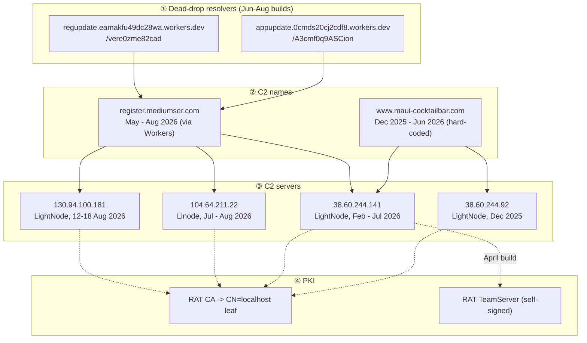

# 06 · Infrastructure

[⬅ Reverse engineering](05-reverse-engineering.md) · **Infrastructure** · [SOC defender guide ➡](07-soc-defender-guide.md)

> **TLP:CLEAR** · as of **2026-10-15** · passive sources only (passive DNS, WHOIS history, certificate transparency, scan-engine archives, sandbox records). Machine-readable: [`hunting/data/`](../hunting/data/), [`iocs/iocs.csv`](../iocs/iocs.csv).

---

## The four layers

---

## ① Dead-drop resolvers

| Host | Path in the binary | Published path | First seen | State 2026-10-15 | Tag |
|---|---|---|---|---|---|
| `appupdate.0cmds20cj2cdf8.workers.dev` | `/A3cmf0q9ASCion` | same | June 2026 | `error code: 1042` | CORROBORATED |
| `regupdate.eamakfu49dc28wa.workers.dev` | **`/vere0zme82cad`** | `/vere0zme82cadre` (wrong) | June 2026 | `error code: 1042` | CORROBORATED · NOVEL (path) |

They still handed out `register.mediumser.com` on **15 Aug 20:10 UTC** (Triage 260815-yx3r4stvdy). By **18 Aug ~15:29 UTC** they **likely** no longer did (Triage 260818-sw2wjadk7v: the implant fetched both and never looked up a C2 name — reply content not visible), and again on **18 Sep** (Triage 260918-gy8w3sbl7v). The change sits somewhere between 40 h before and 28 h after the Seqrite report and serve Cloudflare's 1042 page by **15 Oct 2026** (Joe 1987362). Seqrite's sandbox got `register.mediumser.com` from them (Seqrite gives no date; its run resolved `104.64.211.22`, which places it between 7 Jul and 11 Aug). **Do not block `workers.dev`** — block the two exact hosts.

---

## ② Domains

### `maui-cocktailbar.com` — an aged domain, borrowed for a year

| Window (UTC) | State | Source | Tag |
|---|---|---|---|
| 2018 → 2021 | Legitimate small-business site on shared Dutch hosting (149.210.210.187, 80.69.67.46) | WHOIS history, OTX | EXCLUDED as actor |
| 2021-04 | Lapses | WHOIS history | — |
| **2025-06-06 03:09** | **Re-registered** at Namecheap; listed in the SANS ISC new-domain feed 2025-06-08 | VirusTotal WHOIS, SANS ISC | NOVEL |
| **≤ 2025-12-26** | `www` → **38.60.244.92** | Triage DNS (live) | NOVEL |
| **≥ 2026-02-07** | `www` → **38.60.244.141** | VirusTotal | NOVEL |
| 2026-03-13 → 03-17 | Apex → 27.102.128.147 (DAOU, KR — shared hosting); Let's Encrypt certs 13 and 16 Mar; MX `email.maui-cocktailbar.com` + SPF `v=spf1 a mx -all` 14 Mar → 25 Apr | Validin, CT | NOVEL (low weight) |
| ~2026-06-06 | Expires | WHOIS | NOVEL |
| 2026-06-16 → 06-30 | Registrar parking (172.234.24.211, 172.239.57.117; June certs are the parking service's) | Validin | EXCLUDED |
| July 2026 | Aftermarket lander | Validin, VirusTotal | EXCLUDED |
| 2026-08-18/19 | Deleted from the registry | WHOIS | NOVEL |
| **2026-09-29** | Re-registered by an **unrelated** party | WHOIS; Malwarebytes domain age 15 days on 2026-10-15 | EXCLUDED as actor |

The operator picked a domain with years of clean history, held it **six months before first use**, and let it lapse at the first renewal.

### `mediumser.com` — purpose-registered

| Field | Value | Source | Tag |
|---|---|---|---|
| Registered | 2026-03-20, NameSilo | Seqrite; WHOIS | CORROBORATED |
| Registrant e-mail | `jack.amy2015@atomicmail.io` — the **only** domain on it (reverse WHOIS) | WHOIS, reverse WHOIS | NOVEL |
| DNS | Cloudflare (`kelly.ns.cloudflare.com`) from 2026-04-29 | Seqrite; Validin | CORROBORATED |
| Certificates | Cloudflare-issued apex certificates continue after the report (CT entries 2026-06-27 and 2026-08-25; a further renewal 2026-09-13) | CT (ScanMalware connector; crt.sh) | NOVEL |
| `register.mediumser.com` | ≥2026-05-12 → 38.60.244.141 · 2026-07-01..07-06 → 38.60.244.141 · 2026-07-07..08-11 → 104.64.211.22 · **2026-08-12..08-18 → 130.94.100.181** · **NXDOMAIN from 2026-08-19** | VirusTotal; Validin; SecurityTrails; OTX; Triage | CORROBORATED · NOVEL (first and last windows) |

The zone is still alive on Cloudflare: re-adding one record would re-arm every orphaned implant that still reaches a repaired Worker.

---

## ③ C2 servers

| IP | ASN | Geo | Actor window | Evidence | Tag |
|---|---|---|---|---|---|
| **38.60.244.92** | AS154177 LIGHT NODE LIMITED | Yangon, MM | ≤ 2025-12-26 | Live DNS + QUIC flow from the December build | **NOVEL** |
| 38.60.244.141 | AS154177 LIGHT NODE LIMITED | Yangon, MM | ≥ 2026-02-07 → 2026-07-06 | VirusTotal (www, register), Triage April run, Validin | CORROBORATED (window NOVEL) |
| 104.64.211.22 | Akamai / Linode | — | 2026-07-07 → 2026-08-11 | Validin; SecurityTrails 07-24 → 08-13 | CORROBORATED (held at *likely*) |
| **130.94.100.181** | AS154177 LIGHT NODE LIMITED | Yangon, MM | 2026-08-12 → 2026-08-18 | Validin, SecurityTrails, VirusTotal, OTX, Triage August run | **NOVEL** |
| 27.102.128.147 | DAOU Technology | KR | 2026-03-13 → 03-17 (apex only) | Validin | NOVEL (roughly even chance) |

### Patterns — NOVEL

| Pattern | Weight | Use |
|---|---|---|
| **3 of 4** actor-held C2 IPs on **LightNode AS154177, Yangon** — two in the same /24 (38.60.244.0/24), and a **return** to LightNode after the Linode period | Moderate (for prediction) · none for attribution | Watch AS154177 for new QUIC / RAT CA hosts |
| C2 never answered a sandbox (0 server packets in four runs, eight months apart) | Low–moderate | Possible source filtering — sandboxes will under-report C2; rely on DNS and certificates |
| Short leases: one week for 130.94.100.181, five weeks for 104.64.211.22 | Low | Expect rapid IP rotation; hunt by certificate and SNI |

`104.64.211.22` now hosts an unrelated workload. We did not probe it and do not publish its current services. Hunt it **only inside its window**.

---

## ④ Certificates

| Certificate | SHA-256 | Seen | Hunt with |
|---|---|---|---|
| RAT CA | `dad3fa948af98c55a2029c93999661264c37eb432ef42fdef402326393cfbd0a` | embedded (agent lineage) | issuer CN `RAT CA` |
| C2 leaf `CN=localhost` | `6b348f7ad068f0324fcf0fff6e91437adb5edd8d2301e44cc0888ef2a8fd43ca` | **Censys 2026-07-15 09:16 UTC** | issuer CN `RAT CA`; AKI `f2f17b88…` |
| RAT-TeamServer | `2290c2a6576eb32eb0810e9d67f83ceae2e372f32b44c7438828a25de8679988` | embedded (rat/agent); **null** on Censys (Shodan / FOFA open) | subject CN `RAT-TeamServer` |

Details and the reconstruction proof: [05 §8](05-reverse-engineering.md#8--certificates). Query strings: [`hunting/queries/`](../hunting/queries/).

---

## The lure factory — one container, eight decoy slots

The ACMECS VHD is not a one-off: its Recycle Bin is a log of the same container being re-armed for months. "In" = FAT creation stamp of the file (local clock of the writing machine); "Out" = `$I` deletion time (UTC) with the deleting machine's offset.

**Counting rule:** a *decoy slot* is one PDF that sat in the decoy position. The Recycle Bin holds **7 deleted decoy PDFs**; with the current one that is **8 slots**. Two slots held the same 265-byte stub and one is 0 B, so **4 slots carried a real document**. The current `ACMECS_Pillar_1.pdf` (4,117 B) is **not a valid PDF**: a `%PDF-1.7` header, no objects or pages, and a `startxref` (69,580) past its own end — its last 203 bytes are byte-identical to the tail of the 70,213-byte `5-14-2026.pdf`. A victim opening it **sees an error**, while the payload still runs (NOVEL).

| Decoy slot / payload | In (local) | Out (UTC) | Out clock | Size | Notes |
|---|---|---|---|---|---|
| **Old payload** `header.doc` | 2026-01-12 22:15:00 (= 01-13 06:15 UTC on the UTC−8 clock) | **2026-05-14 01:37:35** | UTC−7 | 652,141 | Likely `agent` lineage, layout closest to the December build ([05 §9](05-reverse-engineering.md#9--the-deleted-headerdoc--an-earlier-payload)) |
| `25-1-2026.pdf` | 2026-01-29 00:49:52 | 2026-02-04 03:26:24 | UTC−3 | 0 (content lost) | |
| `Unofficial_Translation.pdf` | 2026-02-07 00:22:08 | 2026-03-18 02:06:20 | UTC−3 | 265 (stub) | Same 265-byte stub reused below |
| `5-14-2026.pdf` (stub) | 2026-02-07 04:22:08 | 2026-05-14 01:27:12 | UTC−3 | 265 | |
| `Virtual_Training_Programme.pdf` | 2026-03-20 23:02:12 | 2026-03-25 03:44:06 | UTC−3 | 127,876 | BIMSTEC / MISIS concept note |
| `5-14-2026.pdf` | "2026-05-16 22:26:32" | 2026-05-14 01:48:50 | UTC−3 | 54,759 | **Clock conflict**: created after it was deleted → two clocks ≥ 2 days apart |
| `5-14-2026.pdf` | 2026-05-16 22:26:32 | 2026-06-25 07:19:29 | UTC−3 | 70,213 | "Inside Story of Trump's Visit to China" (Myanmar MFA look-alike) |
| `TrainingAnnouncement.pdf` | 2026-06-25 04:19:30 (= 07:19:30 UTC) | 2026-06-26 15:43:26 | UTC−3 | 106,591 | Seqrite's decoy `575305cd…` — swapped in **one second** after the previous decoy left |
| **`ACMECS_Pillar_1.pdf`** (current) | 2026-06-26 12:43:25 (= 15:43:25 UTC) | — | — | 4,117 | Swapped in **one second** before TrainingAnnouncement.pdf left. **Corrupt** — reuses the 5-14-2026.pdf trailer |
| **Current payload** `header.doc` + `body.doc` (= June build `cd147efe`) | content last modified **2026-06-25 04:27:42** local, clock unknown (placed on or after it); `header.doc` carries the deleted file's creation time — **likely** a replacement written within seconds of the 14 May deletion (file-system tunnelling) | — | — | 3,523,328 × 2 | Which payload sat in the slot from 14 May to 25 Jun is unknown |

What this changes (NOVEL):

- Seqrite treated the deleted documents as **not associated** with the campaign. Their timing says each one **was the container's decoy** for a period. Whether each was sent to a victim is unknown — hunt for them as lures (hashes in [`iocs/file-hashes.csv`](../iocs/file-hashes.csv)).
- The **ACMECS** container is the **TrainingAnnouncement** container re-armed on 26 Jun 2026. `TrainingAnnouncement.jpg` is **likely** a copy of the same container taken on 25–26 Jun: Seqrite lists the same Virtual_Training_Programme and two 5-14-2026 documents in its Recycle Bin, plus one (`Recent_dev_from_Malaysia`) that is not in ours.
- Payload and decoys were handled on **different clocks** (UTC−8/−7 vs UTC−3) inside the same 21-minute session on 14 May — a VM and a host, or two people on shared storage.
- The `.lnk` and the ftp script were last modified **2026-07-30 22:09–22:10 local** — after the ACMECS decoy went in, so the container was touched again a month later.

Reproduce: `python3 -I tools/vhd_recycle_timeline.py ACMECS_Pillar_1.vhd`.

---

## Related — the GriefLure template

| Indicator | Role | Tag |
|---|---|---|
| `whatsappcenter.com` | GriefLure C2 (May 2026; last seen in OTX 2026-05-12) | PUBLISHED |
| `a9547e38…` RAR, `35af2cf5…` LNK | Viettel-themed Vietnamese archive with the `_/_/j/_rels/` layout, 18 Aug 2026 | NOVEL |

Full list: [`iocs/related-grieflure.csv`](../iocs/related-grieflure.csv).

---

## Excluded pivots

Sixteen addresses and time windows look related but are not (parking, aftermarket, legitimate prior owner, a bystander, a hostname collision). Reasons and dates: [`iocs/excluded.csv`](../iocs/excluded.csv). The biggest trap: **anything `maui-cocktailbar.com` resolved to after 6 Jun 2026**.

---

## Connector snapshot (2026-10-15)

| Connector | Query | Result |
|---|---|---|
| Malwarebytes | 2 Worker URLs, `register.mediumser.com` URL, `www.maui-cocktailbar.com` URL, registrant e-mail | Workers, register URL, e-mail: **unknown**. `maui-cocktailbar.com`: **suspicious**, domain age 15 days (the new owner) |
| ScanMalware | domain scans / CT for `mediumser.com` | No scans; 2 CT entries (2026-06-27, 2026-08-25) |
| ThreatCluster | QUICSILVER, QUICAgent, mediumser (7 days) | **No clusters** |
| ipinfo | 38.60.244.92 / .141, 130.94.100.181 | All AS154177 LIGHT NODE LIMITED, Yangon |
| OTX | passive DNS 38.60.244.92 | **Empty** |
