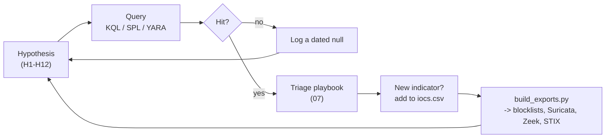

# 08 · Threat-hunting playbook

[⬅ SOC defender guide](07-soc-defender-guide.md) · **Threat hunting** · [Methodology ➡](09-methodology-and-corrections.md)

> **TLP:CLEAR** · as of **2026-10-15** · for threat hunters and CTI analysts. Endpoint and network hunts run on your own telemetry; external pivots are **passive** (scan-engine and passive-DNS archives — never touch the hosts).

---

## 🎯 Why hunt now

- The implant fleet is **orphaned, not gone**: both Workers serve an error page and the C2 name is NXDOMAIN, but the `mediumser.com` zone is still alive. One DNS record or one Worker fix re-arms every infection.
- The operator has **rebuilt after exposure before** (June, after GriefLure) and keeps returning to **LightNode**.
- The December build sat on a public sandbox **four months** before the first report: retro-hunts find what alerting missed.

---

## 🔁 The hunt loop

---

## 🧭 Hypotheses at a glance

| # | Hypothesis | Data | Query | Look-back |
|---|---|---|---|---|
| **H1** | A user opened a VHD lure and the LNK ran `ftp.exe -s` | Process | KQL Q01, Q10 · SPL S01, S10 | 330 d* |
| **H2** | The split payload was rebuilt with `copy /b` | Process | Q02 · S02 | 330 d* |
| **H3** | QUICAgent persisted through `Startup\SystemIn.lnk` | File, process | Q04 · S04 | 330 d* |
| **H4** | The December build installed into `SystemPublicCache` | File, process | Q05 · S05 | 330 d* |
| **H5** | The April build ran (`original_path.txt`, `C:\Users\Public\*.exe`) | File | Q06 · S06 | 330 d* |
| **H6** | A non-browser process speaks QUIC from a user-writable path | Network | Q07 · S07 | 30 d (baseline) |
| **H7** | A process fetched from `*.workers.dev` and then went to UDP/443 (resolver pattern, any new Worker) | Network | Q11 · S11 | 30 d |
| **H8** | Hosts contacted the known C2 inside its window | Network, DNS | Q08 · S08 | 330 d* |
| **H9** | A **new** QUICAgent build exists in your file corpus | Files | YARA `C2_Protocol`, `RC4_Key_Builder`, `*_Pin` | all |
| **H10** | VHD / disguised-VHD attachments reached mailboxes | Mail | YARA `VHD_Lure_Container`; size > 1 MB `.jpg` with `conectix` footer | 330 d* |
| **H11** | Operator hands-on activity from the implant | Process | Q12 · S12 | 330 d* |
| **H12** | New C2 servers exist on the internet with the RAT CA leaf | Scan engines | [`hunting/queries`](../hunting/queries/) | weekly |

\* **330 days covers the whole campaign (Dec 2025 →), but native Defender XDR advanced hunting only holds 30 days.** The KQL ships with `ago(30d)`; raise it to `330d` only on tables retained in Microsoft Sentinel (analytics tier) or another SIEM. Splunk: as far back as your index retention allows.

---

## 📏 What normal looks like

| Signal | Normal | Suspicious |
|---|---|---|
| `ftp.exe` | Almost never on user endpoints; scheduled jobs on servers | Any user-session `ftp.exe -s`, parent `explorer.exe` |
| `copy /b` | Build scripts joining text or binary parts on developer machines | `.doc` + `.doc` → `.exe` |
| QUIC (UDP/443) | Browsers, Teams, Zoom, Discord, Steam, OS update services | Unsigned binaries in `%LOCALAPPDATA%`, `C:\Users\Public`, `%TEMP%` |
| `*.workers.dev` | Web apps in browsers | A non-browser process, once at start-up, then UDP/443 |
| Startup folder `.lnk` | Software installers (signed parent) | `powershell.exe -WindowStyle Hidden -ExecutionPolicy Bypass` writing it; name `SystemIn.lnk` |
| `*.hta` deleted from Downloads | The user, the browser, or AV | Deleted by an unsigned EXE that just opened a PDF (April build) |

---

## 🔬 Hunt notes

### Endpoint — H1 to H5, H11

- **H1**: the LNK's `-s"":` defeats a plain `-s:` match — the KQL and Sigma rules use a regex that accepts both. Keep `ExactTemplate` hits separate: they are the actor's folder nest.
- **H3**: Defender may record the shortcut write as `powershell.exe` → `SystemIn.lnk`; the `.ps1` itself is deleted after use, so `create_lnk_*.ps1` may only appear as a create event.
- **H4/H5**: the December build **skips** its install step if Bitdefender or SentinelOne runs; the April build skips it if SentinelOne or Trend Micro runs. In April, Bitdefender only changes the relaunch (`cmd /c` instead of `WScript.Shell`). When the install is skipped, pivot to H6 for the launch path.
- **H5**: the April build deletes every `*.hta` in the user's Downloads (KQL Q06 / SPL S06) — likely its own delivery file. Look for the HTA in mail and proxy logs.

### Network — H6, H7, H8

- The SNI sits in the **encrypted** ClientHello of the QUIC Initial, but the Initial keys come from the **public** Destination Connection ID — no secret is needed. Sensors that decrypt Initials (Suricata 7 `quic.sni`, Zeek's QUIC analyser, Wireshark) read it; a plain header parse does not.
- A QUICAgent host whose C2 is gone emits a steady train of **1,280-byte** UDP/443 packets with no answers.
- Respect the windows in [`quicsilver-timebound.csv`](../iocs/blocklists/quicsilver-timebound.csv).

### Files — H9, H10

- YARA `QUICSILVER_QUICAgent_C2_Protocol` keys on the C2 paths and headers, not the certificate or C2 name — it survives a re-key and a new resolver. It **requires quic-go**: for a non-QUIC rebuild, hunt with a copy that drops `$quic`.
- YARA `QUICSILVER_QUICAgent_RC4_Key_Builder` keys on the `movabs` sequence that builds the RC4 key — it also fires on process memory and on the current first half `header.doc` (`4a1a1b14…`; not on the deleted 652 KB fragment, whose code ends before the key builder).
- Retro-hunt on VirusTotal / your sandbox with the rules in [`quicsilver.yar`](../detections/yara/quicsilver.yar); report new builds privately first.

---

## 🔭 Passive external pivots

Queries used or prepared during this investigation — which were run, and their results, are in [`hunting/queries/internet-scan-pivots.md`](../hunting/queries/internet-scan-pivots.md).

| Engine | Query | What it finds |
|---|---|---|
| Censys (certificates) | `cert.parsed.issuer.common_name: "RAT CA"` | The RAT CA–signed `CN=localhost` leaf (run: one hit, first seen 2026-07-15) |
| Shodan | `ssl.cert.issuer.cn:"RAT CA"` | Hosts serving a RAT CA–issued certificate over TLS (open) |
| Shodan | `ssl.cert.subject.cn:"RAT-TeamServer"` | The April lineage's server certificate (open) |
| FOFA | `cert="RAT-TeamServer"` | Same, FOFA index (open) |
| FOFA | `ip="38.60.244.92"` | History of the December C2 |
| Validin / VirusTotal | `38.60.244.92`, `130.94.100.181`, `register.mediumser.com` | Passive DNS and communicating files |

Do **not** use `ssl:"RAT System"` on Shodan: it matches the hostname `rat-system.ddns.net` (excluded).

---

## 🧩 Open leads

| # | Lead | Next step | Value |
|---|---|---|---|
| L1 | `bf8afbd1c2074c7cd6ff8b86dbe67a57ca5594817e46b24e226b71c4edde7697` — VirusTotal says it communicates with `maui-cocktailbar.com`; not on Triage or MalwareBazaar | Check its size: **7,007,744 B** would make it the full payload behind the deleted `header.doc` (verify: its first 652,141 B must hash to `b1fd6a1c…`) | High |
| L2 | `TrainingInstructions (1).vhd` — VirusTotal, 2026-08-17, 0/59; SHA-256 begins `03eabf7b` | Obtain and run `vhd_recycle_timeline.py` | High |
| L3 | The 18 Aug 2026 Viettel-themed LNK `35af2cf5…` | Run `lnk_tracker.py`; same MAC `80:45:dd:e5:91:6e` / label `我的磁盘` = same builder | Moderate |
| L4 | Censys host for the 2026-07-15 leaf | Censys certificate → hosts history | Moderate |
| L5 | LightNode AS154177 hosts with UDP/443 and a RAT CA leaf | Weekly certificate queries (H12) | Moderate |
| L6 | `27.102.128.147` (March apex) | Validin history of the IP | Low |

---

## 📅 Hunt calendar

| Cadence | Hunt |
|---|---|
| Once (now) | H1–H5, H8, H11 over 330 days where your retention allows (30 days in native Defender XDR); H9 across file stores |
| Weekly | H12 (certificate queries); Validin on `mediumser.com` subdomains; DNS of both Workers |
| Daily (automated) | H6 / H7 as scheduled queries; Sigma rules live |
| On any new report | Re-run H9 with updated YARA; add indicators to `iocs.csv` and rebuild exports |
